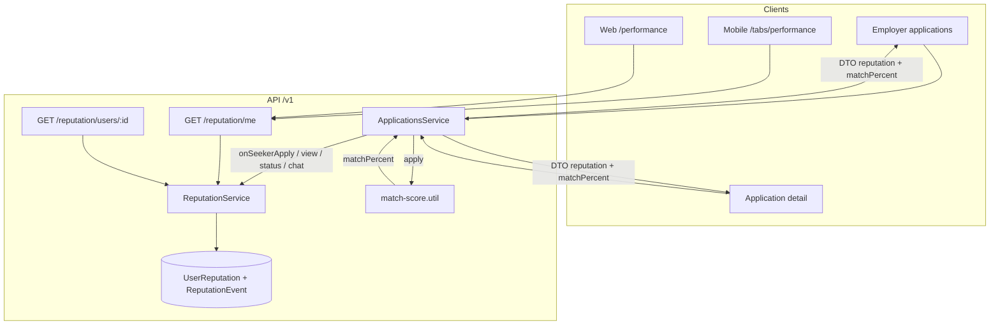

# Performance Score (seeker + recruiter)

Trust signal that rewards disciplined applications and responsive communication. Separate from spam velocity badges and subscriptions — exists to give **both** job seekers and recruiters confidence.

## Goals

- Seekers: apply to roles that fit; reply when recruiters message.
- Recruiters (employers): open applications, move status, reply in chat.
- Fit under 50% **lowers** seeker score; fit ≥50% **raises** it.

## Score model

| | |
| --- | --- |
| Range | 0–100 |
| Start | 50 (Steady) |
| Bands | Rising ≥70 · Steady 50–69 · Needs care &lt;50 |

### Seeker deltas

| Event | Δ | Cap / rule |
| --- | --- | --- |
| Active apply | +1 | 3 / UTC day |
| Good fit (≥50%) | +4 | 8 / day |
| Poor fit (&lt;50%) | −5 | uncapped (discourages spray) |
| Chat reply after recruiter | +2 | 6 / day |

### Employer deltas

| Event | Δ | Cap / rule |
| --- | --- | --- |
| First application view | +1 | 8 / day |
| Status advanced | +2 | 8 / day |
| Chat reply after seeker | +2 | 6 / day |

### Match % (at apply)

`api/src/reputation/match-score.util.ts`

1. Skills overlap vs job `skills` + `description.requirements` (70% weight).
2. Experience band vs `experienceLabel` (30% weight).
3. Stored on `JobApplication.matchPercent` and shown on employer/seeker UI.

## End-to-end flow

## Surfaces

| Surface | What users see |
| --- | --- |
| `/tabs/performance` (mobile) · `/performance` (web) | Own score, band, how-it-works, tips, event ledger; seeker/recruiter toggle for employers |
| Account / Saved jobs hub | Compact My Rating strip on `/me` (+ Account Rating tab) |
| Employer applicant list + detail | Seeker score band + role fit % |
| Seeker application rows | Fit % + recruiter score |
| Drawer (web) | **My Rating** nav (`/performance`) |

## API

| Method | Path | Notes |
| --- | --- | --- |
| GET | `/v1/reputation/me?role=` | Tips + ledger |
| GET | `/v1/reputation/users/:userId?role=` | Public band for counterpart |

Env: `REPUTATION_STORE=prisma|memory` (falls back to `JOBS_STORE`). Migration: `20261104240000_user_performance_score`.

## Module

`api/src/reputation/` — see [CLAUDE.md](../api/src/reputation/CLAUDE.md).
